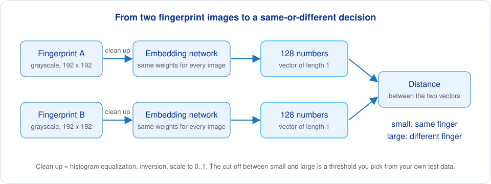
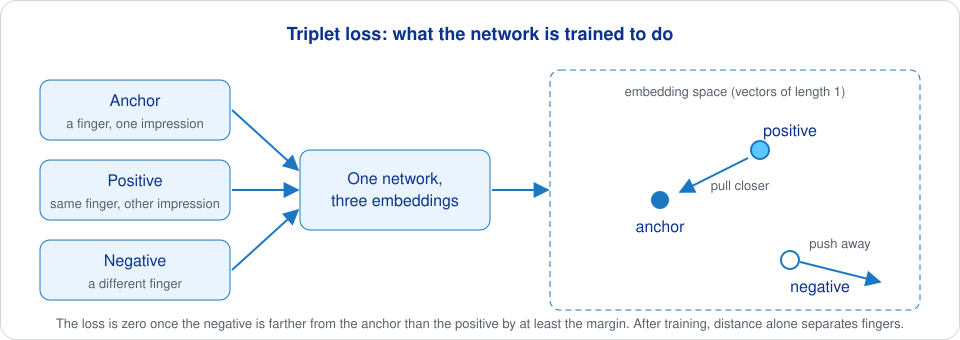

# Fingerprint recognition model

Research code for a fingerprint matcher built on a neural network. The network reads a 192 x 192 grayscale fingerprint image and turns it into an embedding: a list of 128 numbers of unit length. Two impressions of the same finger give embeddings that lie close together, impressions of different fingers lie far apart, so comparing two fingerprints comes down to measuring the distance between two short vectors. The network is trained with triplet loss on the CASIA-FingerprintV5 dataset. You get the model definition, a triplet generator, a training script and an evaluation script in Keras.

## What it does

- Defines an Xception-style convolutional network that maps a fingerprint image to a 128-number, L2-normalized embedding.
- Samples training triplets (anchor, positive, negative) from CASIA-FingerprintV5 with on-the-fly augmentation.
- Trains the network with triplet loss and saves checkpoints and a SavedModel.
- Embeds a held-out test set, compares every pair of images by Euclidean distance and plots the distance histograms of same-finger and different-finger pairs.



## Quick start

`requirements.txt` pins TensorFlow 2.11.0 and Keras 2.11.0 (they support Python 3.7 to 3.10) and lists `matplotlib`, `numpy` and `opencv-python`. Keras image augmentation also needs `scipy`, which is not listed. `fingerprint_enhancer` and `fingerprint-feature-extractor` are listed but not imported by the current code.

```bash
pip3 install -r requirements.txt scipy
```

Put CASIA-FingerprintV5 in a folder named `fingerprint-v5-master` next to the scripts, in its original layout: one folder per subject, `L` and `R` inside, and files named `<subject>_<hand><finger>_<sample>.bmp` with finger 0 to 3 and sample 0 to 4. The code builds these names itself and expects all 20 files in every hand folder.

```text
fingerprint-v5-master/
├── 000/
│   ├── L/
│   │   ├── 000_L0_0.bmp
│   │   └── ... 000_L3_4.bmp
│   └── R/
│       └── 000_R0_0.bmp ...
└── 001/ ...
```

Move the subjects you want to test on into a second folder, `fingerprint-v5-master-test`, before training. Then:

```bash
python3 train.py   # 256 epochs, writes fingerprint_model/, saved_model/ and train_metrics.png
python3 test.py    # reads saved_model/ and fingerprint-v5-master-test/, writes test_metrics.png
```

Both scripts have no command-line arguments and read their paths relative to the working directory, so run them from the repository root.

## How it works

**Preprocessing.** Every image, in training and in testing, is read as 8-bit grayscale, resized to 192 x 192, passed through histogram equalization, inverted (ridges become bright on dark) and scaled to [0, 1].

**The network.** `model.py` builds a network in the style of Xception: two plain convolutions, three residual blocks of separable convolutions with max pooling (128, 256 and 728 filters), eight middle blocks of 728 filters, an exit block up to 2048 filters, global average pooling and a dense layer of 128 units. The last step is L2 normalization, so every embedding has length 1 and distances between embeddings stay in a fixed range. There is no batch normalization and no dropout. On `main` the 128-unit layer has a ReLU activation; [pull request #1](https://github.com/biometric-technologies/fingerprint-recognition-model/pull/1) removes it, because a ReLU before normalization keeps all embeddings in one corner of the sphere.

**Triplets.** `tripplet_generator.py` is a Keras `Sequence`. Each batch is drawn at random: a subject is picked, and for each hand an anchor (random finger and sample), a positive (same finger, different sample) and a negative (a random finger of another subject) are loaded, preprocessed and augmented independently with rotation up to 20 degrees, shifts of 0.2, shear 0.2 and zoom 0.2. Subjects are split 80 % for training and 20 % for validation. With `batch_size` 64 in `train.py`, a batch holds 128 triplets, two per subject draw.

**Triplet loss.** The same embedding network processes all three images with shared weights. The loss asks the anchor to be closer to the positive than to the negative by at least a margin, measured in squared Euclidean distance; once that holds for a triplet, its loss is zero. On `main` the margin is 1.0. The script trains with Adam at the Keras default learning rate for 256 epochs, keeps the triplet model in `fingerprint_model/checkpoint_NN.hdf5` after each epoch that improves validation loss, and saves the final triplet model to `saved_model/`.



**Evaluation.** `test.py` loads `saved_model`, takes the shared embedding network out of the triplet model (`layers[3]`), embeds every image in `fingerprint-v5-master-test` and computes the Euclidean distance for every pair. Pairs from the same finger are genuine pairs, all others impostor pairs; the histogram of both goes to `test_metrics.png`, which is the most useful output: a good model shows two well-separated humps. The script also prints rates at the fixed distance threshold 1.0, but on `main` the counting is inverted (genuine pairs above the threshold are counted as correct) and the printed names are presentation attack metrics (APCER, BPCER, ACER) rather than matching metrics, so treat those numbers as placeholders.

### Changes in pull request #1

The open [pull request #1](https://github.com/biometric-technologies/fingerprint-recognition-model/pull/1), branch `embedding-fixes`, changes the model, the sampling and the evaluation, and comes with a detailed readme. In short: the ReLU on the embedding layer is removed, the margin goes from 1.0 to 0.3 to suit squared distances between unit vectors, half of the negatives are taken from other fingers of the same hand (harder examples), horizontal flips are dropped from augmentation (a mirrored fingerprint is not a real finger), the subject split is seeded, and `test.py` reports FMR (false match rate), FNMR (false non-match rate), EER and FNMR at fixed FMR as defined in ISO/IEC 19795-1, the standard for biometric performance testing. Models trained on `main` must be retrained after the change.

## Numbers

The repository has no published results and no trained weights. To get a figure you can quote, keep a fixed list of test subjects out of training, run `test.py`, and report the number of subjects and pairs together with the commit. Distance thresholds depend on the sensor and the population, so measure again on images from your own device before choosing one.

## Where it is used

This model is not part of a shipped Iriscan product yet. The [Biometric SDK](https://github.com/biometric-technologies/biometric-sdk) lists its `finger` module as unavailable, and fingerprint interchange at Iriscan is handled by [biometric-converter](https://github.com/biometric-technologies/biometric-converter), which converts fingerprint images to ANSI/INCITS 378 and ISO/IEC 19794-2 minutiae templates (the ISO fingerprint template format) with NIST NBIS. An embedding from this network cannot be compared with a minutiae template: it only compares with embeddings from the same model version and preprocessing. This repository is where the embedding approach is developed and measured before it is considered for the SDK.

## Related repositories

- [biometric-sdk](https://github.com/biometric-technologies/biometric-sdk): Kotlin Multiplatform SDK for face, iris and fingerprint modalities.
- [biometric-converter](https://github.com/biometric-technologies/biometric-converter): fingerprint image and template converter built on NIST NBIS.
- [nist-biometric-image-software-nbis](https://github.com/biometric-technologies/nist-biometric-image-software-nbis): mirror of NIST NBIS with MINDTCT minutiae detection and BOZORTH3 matching.
- [liveness-detection-model](https://github.com/biometric-technologies/liveness-detection-model): face liveness model, the other training repository of this organization.
- [biometric-models-onnx-converters](https://github.com/biometric-technologies/biometric-models-onnx-converters): notebooks that convert Iriscan models to ONNX.

## License

License: not yet specified. The repository has no license file; contact Iriscan before reusing the code. CASIA-FingerprintV5 is distributed for non-commercial research and has its own terms.

## Contact

Questions and bug reports: [open an issue](https://github.com/biometric-technologies/fingerprint-recognition-model/issues) or write to info@iriscan.net. More about Iriscan at https://www.iriscan.com.
