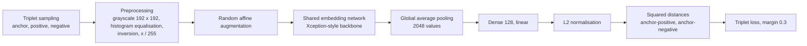
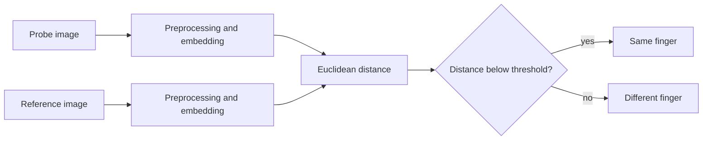

# Fingerprint embedding model

Research code for learning fixed-length fingerprint representations. A
convolutional network maps a 192 x 192 grayscale fingerprint image to a
128-dimensional, L2-normalised embedding. Two impressions of the same finger
should be close in Euclidean distance and impressions of different fingers far
apart, so verification (1:1) is a distance comparison against a threshold and
identification (1:N) a nearest-neighbour search. The network is trained with
triplet loss on CASIA-FingerprintV5.

## Relation to the Iriscan Biometric SDK and products

The [Iriscan Biometric SDK](https://github.com/biometric-technologies/biometric-sdk)
does not use this model. Its fingerprint support is currently limited to reading
and writing ISO/IEC 19794-2 minutiae records, and its README lists the `finger`
module as unavailable. For fingerprint data interchange Iriscan uses
[biometric-converter](https://github.com/biometric-technologies/biometric-converter),
the engine behind [Iriscan BDI](https://www.iriscan.com/biometric-data-interchange),
which converts fingerprint images to ANSI/INCITS 378 and ISO/IEC 19794-2 minutiae
templates with NIST NBIS.

An embedding from this model is not interoperable with minutiae templates: it can
only be compared with embeddings produced by the same model version with the same
preprocessing. This repository is the place to develop and measure such a model
before it is considered for the SDK.

## Contents

| File | Purpose |
| --- | --- |
| `model.py` | Embedding network: Xception-style backbone, linear projection to 128 dimensions, L2 normalisation |
| `tripplet_generator.py` | Keras `Sequence` that samples, preprocesses and augments triplets; subject split into training and validation |
| `train.py` | Triplet loss and the training loop |
| `test.py` | Verification metrics on held-out subjects: FMR, FNMR, EER and FNMR at fixed FMR |

## Architecture

The same embedding network processes the anchor, positive and negative image of a
triplet (shared weights). Training compares squared Euclidean distances between the
normalised embeddings; at test time the Euclidean distance between two embeddings is
the comparison score.





Layers of `create_embedding_model` for a 192 x 192 x 1 input:

| Stage | Layers | Output |
| --- | --- | --- |
| Stem | Conv 3x3, 32, stride 2, ReLU, no padding; Conv 3x3, 64, ReLU, no padding | 93 x 93 x 64 |
| Entry blocks | Three residual blocks of two separable 3x3 convolutions (128, 256, 728 filters) and 3x3 max pooling with stride 2; the shortcut is a 1x1 convolution with stride 2 | 12 x 12 x 728 |
| Middle blocks | Eight residual blocks of three separable 3x3 convolutions, 728 filters, identity shortcut | 12 x 12 x 728 |
| Exit block | Separable 3x3 convolutions (728, 1024 filters), 3x3 max pooling with stride 2, 1x1 convolution shortcut; then separable 3x3 convolutions with 1536 and 2048 filters, ReLU | 6 x 6 x 2048 |
| Head | Global average pooling; `Dense(128)` without activation (`template_output`); `tf.math.l2_normalize` (`normalized_template`) | 128, unit length |

Unlike the original Xception, the network has no batch normalisation and no dropout.
The projection is linear on purpose: a ReLU before the normalisation would keep all
embeddings in the positive orthant and use only a small part of the unit sphere.

## Data

### Dataset layout

The code reads CASIA-FingerprintV5 in this layout:

```text
fingerprint-v5-master/
├── <subject>/
│   ├── L/
│   │   ├── <subject>_L0_0.bmp
│   │   ├── ...
│   │   └── <subject>_L3_4.bmp
│   └── R/
│       ├── <subject>_R0_0.bmp
│       └── ...
└── ...
```

File names are `<subject>_<hand><finger>_<sample>.bmp`, with hand `L` or `R`,
finger 0 to 3 and sample 0 to 4. The generator and `test.py` build these names
directly and expect all 20 files in every hand folder; a missing file stops
training or evaluation with an error. A finger identity is the combination of
subject, hand and finger.

`train.py` reads `fingerprint-v5-master`; `test.py` reads
`fingerprint-v5-master-test`. Both paths are relative to the working directory.

### Splits

- **Training and validation.** `create_casia_v5_generators` sorts the subject folders
  of `fingerprint-v5-master`, shuffles them with seed 24 and assigns 80 % to training
  and 20 % to validation. The split is by subject and reproducible. Triplets for the
  validation set are drawn only from validation subjects.
- **Test.** The code does not create a test split. Before training, move a fixed set of
  subjects out of `fingerprint-v5-master` into `fingerprint-v5-master-test`. The
  validation subjects are used to select checkpoints and cannot serve as an
  unbiased test set.

### Preprocessing

Training and test images go through the same steps:

1. Read as 8-bit grayscale.
2. Resize to 192 x 192, without keeping the aspect ratio.
3. Histogram equalisation (`cv2.equalizeHist`).
4. Inversion, so ridges become bright on a dark background.
5. Scale to [0, 1].

### Triplet sampling

Each item of `CasiaV5TripletGenerator` is a new random batch; the index is ignored.
For every one of `batch_size` draws, a subject is chosen at random from the split
and one triplet is built for each hand:

| Element | Choice |
| --- | --- |
| Anchor | Random finger (0-3) and sample (0-4) of that subject and hand |
| Positive | Same finger, a different sample |
| Negative | With probability 0.5, another finger of the same subject and hand (a hard negative: similar skin and capture conditions). Otherwise a random finger of a random hand of another subject in the same split |

A batch therefore holds `2 * batch_size` triplets. The labels are zeros and are
ignored by the loss.

Each image of a triplet is then augmented independently with Keras
`ImageDataGenerator.random_transform`: rotation up to 20 degrees, width and height
shift 0.2, shear 0.2, zoom 0.2, `nearest` fill. There are no flips, because a
mirrored fingerprint is not an impression of any real finger. Augmentation is applied
to the validation generator as well.

## Training

### Objective

For an anchor $a$, positive $p$ and negative $n$ with normalised embeddings $f(\cdot)$:

```math
L(a, p, n) = \max\left(\lVert f(a) - f(p)\rVert_2^2 - \lVert f(a) - f(n)\rVert_2^2 + m,\ 0\right),\qquad m = 0.3
```

The loss of a batch is the mean over its triplets. Since the embeddings have unit
length, squared distances lie in [0, 4]. The loss is zero once every negative is at
least $m$ further from the anchor, in squared distance, than the positive.

### Settings

`train.py` has no command-line arguments; the values below are set in the code.

| Setting | Value |
| --- | --- |
| Input | 192 x 192 x 1 |
| Embedding size | 128 (also hard-coded in the slicing of `triplet_loss`) |
| Loss | Triplet loss on squared Euclidean distances, margin 0.3 |
| Optimizer | Adam with Keras defaults (learning rate 0.001) |
| Batch | 64 subject draws, 128 triplets |
| Steps per epoch | `floor(2 * F / 64)`, where `F` is the number of files in the `L` folders of the split |
| Epochs | 256, no early stopping |
| Checkpointing | Full triplet model in HDF5 after every epoch that improves `val_loss` |
| Split | 80 % training, 20 % validation subjects, seed 24 |

Outputs, in the working directory:

| Path | Content |
| --- | --- |
| `fingerprint_model/checkpoint_NN.hdf5` | Triplet model at each epoch that improved the validation loss |
| `saved_model/` | SavedModel of the triplet model after the last epoch; read by `test.py` |
| `train_metrics.png` | Training and validation loss per epoch |

The triplet model has three inputs and outputs the three embeddings concatenated
(384 values). `test.py` takes the shared embedding network out of it as
`layers[3]`.

## Evaluation

```bash
python3 test.py
```

`test.py` loads `saved_model`, embeds every image of `fingerprint-v5-master-test`
without augmentation and compares every pair of images once. A pair is **genuine**
when both images come from the same finger (same subject, hand and finger) and an
**impostor** pair otherwise; impostor pairs include different fingers of the same
person. With 20 images per hand folder, a test set of $K$ finger identities gives
$10K$ genuine pairs and $\binom{5K}{2} - 10K$ impostor pairs.

The comparison score is the Euclidean distance $d$ between two embeddings, in
[0, 2]. A pair is accepted as a match when $d < t$. The metrics follow
ISO/IEC 19795-1.

**FMR** (false match rate): the share of impostor pairs accepted as matches. It
measures how often a different finger is taken for the enrolled one.

```math
\mathrm{FMR}(t) = \frac{1}{N_{imp}}\sum_{j=1}^{N_{imp}} \mathbf{1}[d_j < t]
```

**FNMR** (false non-match rate): the share of genuine pairs rejected. It measures how
often the right finger is not recognised.

```math
\mathrm{FNMR}(t) = \frac{1}{N_{gen}}\sum_{i=1}^{N_{gen}} \mathbf{1}[d_i \ge t]
```

**EER** (equal error rate): the error rate at the threshold where FMR and FNMR are
equal. The code tries every observed distance as the threshold and returns the
smallest value of $\max(\mathrm{FMR}, \mathrm{FNMR})$ with its threshold, the usual
approximation on a finite set.

```math
\mathrm{EER} = \min_{t}\ \max\big(\mathrm{FMR}(t),\ \mathrm{FNMR}(t)\big)
```

**FNMR at a fixed FMR**: the FNMR at the threshold that keeps FMR at or below a target
of 1 %, 0.1 % and 0.01 %. This is how verification systems are specified in practice:
the application fixes the acceptable false match rate, and FNMR at that point shows
the cost for genuine users. With impostor distances sorted ascending, the threshold
is the $k$-th smallest, $k = \lfloor \mathrm{target} \cdot N_{imp} \rfloor$; since
matches require $d < t$, the resulting FMR is below the target. A target is skipped
when $k < 1$. An estimate based on a handful of impostor pairs below the threshold is
not reliable; a target FMR needs many times $1/\mathrm{target}$ impostor comparisons.

The script prints the number of genuine and impostor pairs, FMR and FNMR at the fixed
distance threshold 1.0, the EER and its distance, and FNMR at each fixed FMR with its
distance, and saves histograms of genuine and impostor distances to
`test_metrics.png`. A distance of 1.0 between unit vectors corresponds to a cosine
similarity of 0.5; it is a reference point, not a tuned operating threshold.

## Results

The repository contains no measured results, and no trained weights are published.

To produce results that can be reported:

1. Set aside test subjects in `fingerprint-v5-master-test` before training and keep
   that list fixed.
2. Train with `train.py` and run `test.py`.
3. Report the numbers of test subjects, genuine pairs and impostor pairs, the EER,
   FNMR at FMR 0.1 % and 0.01 % with their distance thresholds, the distance
   histogram, and the commit of this repository.
4. For a deployment, measure again on images from the target sensor: distance
   thresholds do not necessarily transfer between sensors or populations.

## Reproducing

Environment: `requirements.txt` pins TensorFlow 2.11.0 and Keras 2.11.0, which
support Python 3.7 to 3.10. Keras image augmentation needs `scipy`, which
`requirements.txt` does not list. `fingerprint_enhancer` and
`fingerprint-feature-extractor` are listed but not imported by the current code.

```bash
python3 -m venv venv
source venv/bin/activate
pip install -r requirements.txt scipy

# Dataset: training and validation subjects in fingerprint-v5-master,
# held-out test subjects moved to fingerprint-v5-master-test
mkdir fingerprint-v5-master-test
mv fingerprint-v5-master/<test subject> fingerprint-v5-master-test/   # repeat for each test subject

python3 train.py
python3 test.py
```

Run both scripts from the repository root.

## Changes on the `embedding-fixes` branch: retraining required

This branch changes the model, the loss and the training data. Models trained
before it must be retrained, and any thresholds or figures derived from them
discarded:

- **Embedding head.** The ReLU on the `template_output` layer was removed. The weight
  shapes did not change, so older checkpoints load without an error, but they were
  trained for a different head and their embeddings do not fit this model.
- **Margin.** The triplet margin went from 1.0 to 0.3, a value suited to squared
  distances between unit vectors.
- **Sampling and augmentation.** Half of the negatives are now other fingers of the same
  hand, horizontal flips were removed, the labels match the real batch size of
  `2 * batch_size` triplets, and the subject split is seeded.
- **Evaluation.** The previous `test.py` counted genuine pairs above the threshold as
  true positives and reported presentation attack metrics (APCER, BPCER) for a
  verification task. Numbers produced with it are not valid. The current script
  reports FMR, FNMR, EER and FNMR at fixed FMR.

## Known limitations

- **Not integrated.** The model is not part of the Biometric SDK, and the repository has
  no export step to TensorFlow Lite or ONNX. Training produces Keras HDF5 checkpoints
  and a SavedModel only.
- **Dataset assumptions.** Paths and file names follow CASIA-FingerprintV5 with exactly
  four fingers and five samples per hand. Other datasets need to be renamed into this
  layout, or the generator and `test.py` adapted.
- **Model selection.** `test.py` evaluates the model after the last of 256 epochs, not
  the checkpoint with the lowest validation loss. The validation loss itself is
  computed on randomly sampled, augmented triplets and varies between epochs, so the
  choice of the best checkpoint is noisy.
- **Sampling.** Batches are random draws with replacement rather than passes over the
  data, triplets are not mined by difficulty, and the random sampling is not seeded,
  so runs are not exactly repeatable. Hard negatives come only from the same hand.
- **Preprocessing.** Images are resized without keeping the aspect ratio, and there is
  no segmentation, orientation normalisation or quality check.
- **Evaluation cost.** `test.py` holds all test images in memory and compares pairs in a
  Python loop, so time grows with the square of the number of images.
- **Dataset license.** CASIA-FingerprintV5 is licensed for non-commercial research.
  Check its terms before using a model trained on it in a product.

## License

This repository does not include a license file yet. Until one is published, contact
Iriscan before reusing the code. Datasets used for training and evaluation are
subject to their own licenses.

## Contributing

Bug reports and feature requests are welcome as
[GitHub issues](https://github.com/biometric-technologies/fingerprint-recognition-model/issues);
please include the command you ran, the package versions and the full error output.
Pull requests are welcome too. A change to the model, sampling or evaluation should
describe the test subjects it was measured on and include the output of `test.py`
before and after the change. Other questions can be sent to
[info@iriscan.net](mailto:info@iriscan.net).

---

Developed by Iriscan (Biometric Technologies OÜ) — [https://www.iriscan.com](https://www.iriscan.com)
